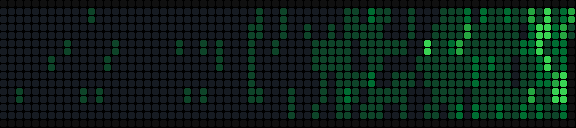
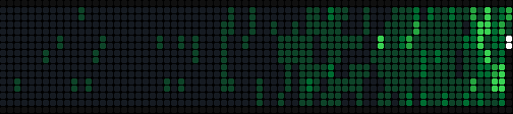
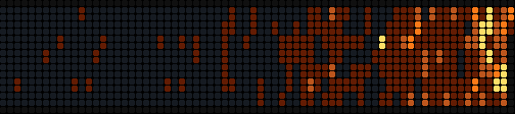
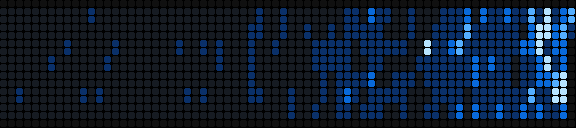
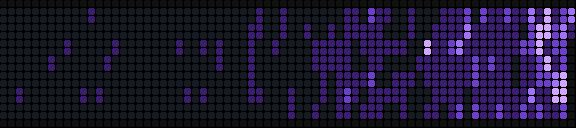
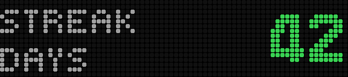
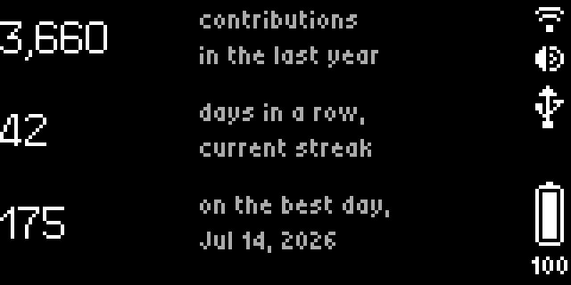
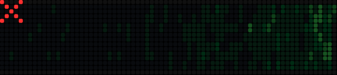
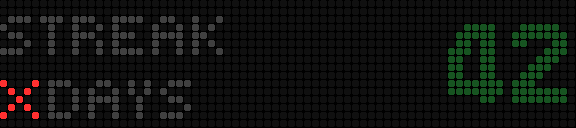
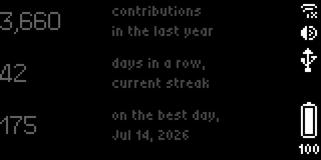

# GitHub Graph

Your GitHub contribution graph on the LED screen.



The front display shows your GitHub contribution graph as GitHub draws it, for the last 72 weeks; today blinks until your first contribution of the day. Turn the wheel for your current streak; the back display has your total for the last year, your streak and your best day. The app needs your GitHub login and a personal access token in its settings.

A JavaScript app for [BUSY Bar](https://busy.app).

## What the bar shows

Until a token is set in the settings, the front display asks for one.


With a token, the front display shows the contribution graph: a column per week, the current week on the right and Sunday on top, 72 weeks across the display. A day is a pixel wide and two tall, in GitHub's shade for its level. The levels are GitHub's own for the last year; the older weeks are given levels on the same scale.

While today has no contribution yet, today's pixel blinks white once a second.



The graph comes in four color schemes: GitHub green, Halloween orange, winter blue and purple.







The wheel switches to your current streak in large digits in the scheme's brightest color: the days in a row with contributions up to today, or up to yesterday while today has none yet. The next turn goes back to the graph.



The back display shows your contributions in the last year, the total your GitHub profile shows; your current streak; and your best day of the last year with its date.



The last good data is kept on the bar and shown dimmed at the start until the first answer. When a request fails, it stays, dimmed, with a red cross over the oldest weeks of the graph, or before DAYS on the streak, and the back display is dimmed too.







Without a connection and with nothing kept for the login, the front display shows `--`.


## Buttons

| Button | What it does |
| --- | --- |
| Wheel | Switches between the graph and the streak. |
| Back | Leaves the app. |

## Settings

| Setting | What it does |
| --- | --- |
| GitHub login | Whose contribution graph to show. Default: vvzvlad. |
| GitHub token | A personal access token; GitHub's GraphQL API answers only with one. Empty by default, and the app then shows SET TOKEN. |
| Colors | The colors of the graph's levels: GitHub green, the default, Halloween orange, winter blue or purple. |

The app reads its settings when it starts.

## Data

The GitHub GraphQL API with your personal access token, which stays in the app's settings on your BUSY Bar: two requests every 30 minutes, one for the weeks before the last year and one for the last year.

## Build

Node 24 and npm:

```sh
npm ci
npm run build         # dist/io.github.vvzvlad.ghgraph.tgz
npm run app:install   # install it on a BUSY Bar connected over USB
npm run app:run       # start it
```

## License

[MIT](LICENSE)
